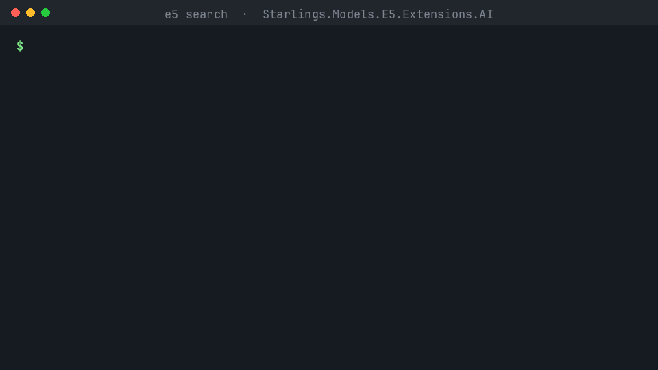

# Starling

**Run real AI models inside your .NET app, with no Python sidecar and no cloud API, and with published evidence that they give the same answers as the upstream reference.**

[](https://www.nuget.org/packages?q=Starlings.Models)
[](https://github.com/starlinghq/starling/actions/workflows/ci.yml)
[](https://dotnet.microsoft.com/download/dotnet/10.0)
[](#license)
[](https://github.com/starlinghq/starling/labels/good%20first%20issue)



Starling packages open models as ordinary NuGet libraries: embeddings, entity extraction, image and video search, and chat. They run on ONNX Runtime on CPU or CUDA and plug into [`Microsoft.Extensions.AI`](https://learn.microsoft.com/dotnet/ai/microsoft-extensions-ai) (`IEmbeddingGenerator`, `IChatClient`), so code you wrote against a hosted provider can switch to a local model with a one-line change. Each model is pinned to an exact upstream commit, verified by SHA-256, and checked against the original PyTorch/Python implementation before it is released.

**Using an AI coding agent?** Point it at [`llms.txt`](llms.txt) or install the [Starling skill](#use-it-with-your-ai-coding-agent).

## Quickstart

Requires the [.NET 10 SDK](https://dotnet.microsoft.com/download/dotnet/10.0). Multilingual semantic search in four commands:

```sh
dotnet new console -o search && cd search
dotnet add package Starlings.Models.E5.Extensions.AI
dotnet add package Microsoft.ML.OnnxRuntime --version 1.30.0
```

Replace `Program.cs` with:

```csharp
using System.Numerics.Tensors;
using Microsoft.Extensions.AI;
using Starlings.Models.E5;
using Starlings.Models.E5.Extensions.AI;

// One-time download, pinned by commit and checked by SHA-256. Inference never touches the network.
E5ModelFiles files = await E5ModelAssets.DownloadAsync();
using var embedder = E5EmbeddingGenerator.Create(files);

// e5 expects "passage: " on documents and "query: " on queries.
string[] docs = ["passage: The Eiffel Tower is in Paris.",
                 "passage: Der Rhein fließt durch Köln.",
                 "passage: 富士山は日本一高い山です。"];
var docVectors = await embedder.GenerateAsync(docs);
var query = await embedder.GenerateVectorAsync("query: Which river runs through Cologne?");

foreach (var (doc, v) in docs.Zip(docVectors))
    Console.WriteLine($"{TensorPrimitives.CosineSimilarity(query.Span, v.Vector.Span):F3}  {doc}");
```

```sh
dotnet run
```

```text
0.680  passage: The Eiffel Tower is in Paris.
0.807  passage: Der Rhein fließt durch Köln.
0.688  passage: 富士山は日本一高い山です。
```

The first run downloads the model (about 487 MB) into your user cache; later runs work offline. The application chooses the ONNX Runtime native package: `Microsoft.ML.OnnxRuntime` for CPU, or `Microsoft.ML.OnnxRuntime.Gpu.Linux` for CUDA on Linux x64.

### Local chat through `IChatClient`

```sh
dotnet add package Starlings.Models.Qwen35.Extensions.AI
dotnet add package Microsoft.ML.OnnxRuntimeGenAI --version 0.17.1
```

```csharp
using Microsoft.Extensions.AI;
using Starlings.Models.Qwen35;
using Starlings.Models.Qwen35.Extensions.AI;

Qwen35ModelFiles files = await Qwen35ModelAssets.DownloadAsync(Qwen35Variant.Fp32x); // about 3 GB, once
using IChatClient chat = Qwen35ChatClient.Create(files);

await foreach (var update in chat.GetStreamingResponseAsync("In one sentence, why is the sky blue?"))
    Console.Write(update.Text);
```

Seven complete programs are in [`ai-dotnet/samples/`](ai-dotnet/samples): semantic search with e5 (`E5Search`) and with an in-memory `Microsoft.Extensions.VectorData` collection (`E5VectorStore`), text, image and video search with EmbeddingGemma 2 (`EmbeddingGemma2Search`), entity extraction with GLiNER2 (`Gliner2Ner`), streaming chat with Qwen3.5 (`QwenChat`), local question answering over your own files (`LocalRag`), and multilingual ticket triage in an ML.NET pipeline (`TicketTriage`).

## Models

Choosing a text embedder? See [choosing an embedding model](docs/guides/choosing-an-embedding-model.md).

| Model | What it does | Package | CPU | CUDA |
| --- | --- | --- | --- | --- |
| [multilingual-e5-small](https://huggingface.co/intfloat/multilingual-e5-small) | Text embeddings, 100 languages | `Starlings.Models.E5` (+ `.Extensions.AI`, `.MLNet`) | Stable | Stable |
| [EmbeddingGemma 2](https://huggingface.co/google/embeddinggemma-2) | Text, image and video embeddings in one space | `Starlings.Models.EmbeddingGemma2` (+ `.Extensions.AI`, `.MLNet`, `.Imaging.SkiaSharp`, `.Video.FFmpeg`, `.Video.FFmpeg9`) | Stable (text, image, video) | Stable (text, image, video) |
| [GLiNER2](https://huggingface.co/fastino/gliner2-base-v1) | Zero-shot entity extraction with any labels | `Starlings.Models.Gliner2` | Stable | Stable |
| [Qwen3.5-0.8B](https://huggingface.co/Qwen/Qwen3.5-0.8B) | Chat and text generation | `Starlings.Models.Qwen35` (+ `.Extensions.AI`) | Stable | Stable (fp32x and fp16x) |

**Experimental, source only (not on nuget.org):** three more libraries build and test on `main` but are not in the release drill's package set, have no Stable profile, and were not published with 0.2.0 ([release record](docs/releases/ai-0.2.0.md#packages)). Build them from this repository.

| Model | What it does | Project | Status |
| --- | --- | --- | --- |
| [Kev-0.8B, Kev-4B](https://huggingface.co/jaredpalmer/kev-0.8b) | Decision models: a calibrated probability per option, no generated text | [`Starlings.Models.Kev`](ai-dotnet/src/Starlings.Models.Kev) | Experimental, CPU fp32; no registry profile yet |
| [all-MiniLM-L6-v2](https://huggingface.co/sentence-transformers/all-MiniLM-L6-v2), [bge-small-en-v1.5](https://huggingface.co/BAAI/bge-small-en-v1.5), [nomic-embed-text-v1.5](https://huggingface.co/nomic-ai/nomic-embed-text-v1.5), [ms-marco-MiniLM-L6-v2](https://huggingface.co/cross-encoder/ms-marco-MiniLM-L6-v2) | BERT text embeddings and reranking | [`Starlings.Models.Bert`](ai-dotnet/src/Starlings.Models.Bert) | Experimental, CPU fp32; proposed evidence only |
| [Qwen3-0.6B](https://huggingface.co/Qwen/Qwen3-0.6B), [Qwen2.5-0.5B-Instruct](https://huggingface.co/Qwen/Qwen2.5-0.5B-Instruct) | Text-only chat | [`Starlings.Models.QwenChat`](ai-dotnet/src/Starlings.Models.QwenChat) | Experimental, CPU fp32; proposed evidence only |

Their candidate contracts are in [`model-pipeline/candidates/`](model-pipeline/candidates) and the BERT and Qwen chat onboarding workflow is in [`model-pipeline/FIVE_MODELS.md`](model-pipeline/FIVE_MODELS.md). The `QwenChat` sample uses the published Qwen3.5 packages, not `Starlings.Models.QwenChat`.

**Stable** means every release gate passed: provenance, numerical parity and task quality against the Python reference, a one-hour leak soak, benchmarks, a clean install from the packages, and integration. It also means regression runs continue: weekly on CPU, and on a GPU before every release for CUDA. Stable on CUDA means Linux x64 with an NVIDIA GeForce RTX 3090, where every CUDA gate and the per-release GPU run take place; other GPUs are untested. On Linux, GLiNER2 (CPU and CUDA) and EmbeddingGemma 2 video on CUDA also need `MALLOC_MMAP_THRESHOLD_=65536` in the process environment; see each package README. The [model catalog](docs/catalog/README.md) links each gate to its evidence, and the [compatibility matrix](docs/catalog/compatibility-matrix.md) lists each platform and provider.

**Release status:** `0.2.0`, published on [nuget.org](https://www.nuget.org/packages?q=Starlings.Models) on 2026-10-17 ([GitHub release](https://github.com/starlinghq/starling/releases/tag/ai-v0.2.0)), is the first release with Stable profiles: the Stable profiles above, Qwen tool calling and the FFmpeg video adapters ([release record](docs/releases/ai-0.2.0.md)). It depends on `Starlings.Tokenizers` `0.3.0`.

## Why Starling

| If you would otherwise... | The trade-off | With Starling |
| --- | --- | --- |
| Call a hosted embedding or chat API | Data leaves the machine, every call costs money, and the model can change under you | The model runs in-process; weights are pinned by commit and hash |
| Run a Python sidecar (sentence-transformers, transformers) | A second runtime to deploy, secure and scale | One `PackageReference`; the Python reference is what we test *against* |
| Call ONNX Runtime directly from C# | You write the tokenizer, pre- and post-processing and parity checks yourself | All of that is included and checked against upstream; [measured](docs/benchmarks/e5-2026-10-09.summary.md) warm latency is within noise of Python on the same backend |
| Use a GGUF chat runtime | Usually chat only, and quantized | Embeddings, extraction, image and video as well as chat; fp32 graphs checked against the original weights |

Starling depends only on the vendor-neutral `Microsoft.Extensions.AI.Abstractions`. CI rejects any Azure or OpenAI SDK dependency in the libraries, so you can adopt it, or leave it, without lock-in.

## Use it with your AI coding agent

Starling includes three files written for coding agents such as Claude Code, Copilot, Cursor and Codex:

- [`llms.txt`](llms.txt) is a short map of the repository: what Starling is, the facts that matter when writing code, and links to the rest.
- [`skills/starling-dotnet/SKILL.md`](skills/starling-dotnet/SKILL.md) is an [Agent Skill](https://agentskills.io) that teaches an agent to use the packages. It covers which package fits which task, the native runtime the app must add, offline loading, verified code for every model, CUDA, and the pitfalls (e5 prefixes, EmbeddingGemma 2 prompts, input limits).
- [`skills/starling-add-model/SKILL.md`](skills/starling-add-model/SKILL.md) is for contributors. It walks an agent through adding a new model in a pull request: choosing the onboarding route, writing the candidate contract, running the `model-pipeline` comparison against a fresh Python reference, and opening a draft PR. It also says what only the maintainer may change.

To give your agent context for a single task, paste this:

```text
Read https://raw.githubusercontent.com/starlinghq/starling/main/llms.txt and
https://raw.githubusercontent.com/starlinghq/starling/main/skills/starling-dotnet/SKILL.md,
then use the Starlings.* NuGet packages to <what you want to build>.
```

To install the skill so it loads whenever it's relevant, for Claude Code:

```sh
mkdir -p .claude/skills/starling-dotnet
curl -fsSL https://raw.githubusercontent.com/starlinghq/starling/main/skills/starling-dotnet/SKILL.md \
  -o .claude/skills/starling-dotnet/SKILL.md
```

Use `~/.claude/skills/` instead of `.claude/skills/` to install it for all your projects. Other agents that support Agent Skills take the same folder. For agents that don't, paste `SKILL.md` into your `AGENTS.md` or rules file.

## Contributing

Issues and pull requests are welcome. Start with a [good first issue](https://github.com/starlinghq/starling/labels/good%20first%20issue), read [CONTRIBUTING.md](.github/CONTRIBUTING.md), and use the [issue templates](https://github.com/starlinghq/starling/issues/new/choose) to request a model or report a regression. Security reports go through [SECURITY.md](.github/SECURITY.md).

### Build and test

Requires the .NET 10 SDK (pinned in `global.json`) and Python 3.11+.

```sh
dotnet test --solution ai-dotnet/AI.slnx
python3 -I tools/check-boundary.py

cd model-pipeline
pip install -e '.[dev]'
python3 -m pytest
ruff check .
ruff format --check .
model-pipeline validate registry
```

### Repository layout

| Directory | Contents |
| --- | --- |
| [`ai-dotnet/`](ai-dotnet) | .NET libraries, backend adapters, model implementations, samples, benchmarks. |
| [`model-pipeline/`](model-pipeline) | Manifest schema, model registry, admissions, candidate contracts and onboarding recipes, reference runners, evaluation, protected fixtures. |
| [`browser/`](browser) | The WebAssembly feasibility spike for e5 in the browser (`browser/spike/`); no browser package yet. |
| [`docs/`](docs) | Plan, generated catalog, guides, benchmarks, evidence and release records ([index](docs/README.md)). |
| [`skills/`](skills) | Agent Skills for using Starling and for adding a model. |
| [`.github/`](.github) | Charter, contribution and support policy, security reporting, issue templates, CI. |
| [`tools/`](tools) | Repository checks (boundary, provenance), model acquisition, release drills, release gates, qualification and the CUDA CI pod scripts (`tools/ci/`). |

The tokenizer is its own product, [`Starlings.Tokenizers`](https://www.nuget.org/packages/Starlings.Tokenizers) from [starlinghq/tokenizers](https://github.com/starlinghq/tokenizers). The execution plan is [`docs/plan/fast-faithful-ai-dotnet.md`](docs/plan/fast-faithful-ai-dotnet.md), and open decisions are in [`docs/kickoff.md`](docs/kickoff.md). An experimental [five-model CPU onboarding workflow](model-pipeline/FIVE_MODELS.md) covers additional Qwen and BERT models; its references are still proposals. nomic-embed-text-v1.5 joined the BERT route afterwards (#120).

## License

Original code is licensed under the MIT License or the Apache License, Version 2.0, at your option ([LICENSE-MIT](LICENSE-MIT), [LICENSE-APACHE](LICENSE-APACHE)), copyright StarlingHq. Model weights, tokenizer assets, and datasets keep their own terms; the code license does not cover them.
