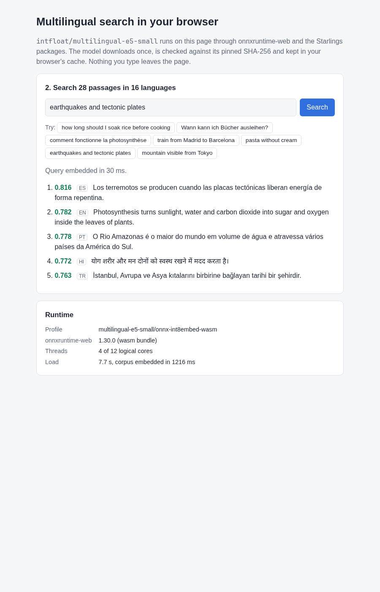

# E5BrowserSearch

Multilingual semantic search that runs entirely in the browser. It's a standalone Blazor WebAssembly app on `Starlings.Models.E5.Browser`: `intfloat/multilingual-e5-small` on onnxruntime-web, with the owned tokenizer and the same pooling code as the server-side `Starlings.Models.E5`.

The app does three things:
- **Loads the model once.** The graph comes from the Hugging Face Hub (fp32) or your own host (int8-embed). It is checked against its pinned SHA-256 and kept in the browser's Cache Storage, so later visits load from the cache.
- **Embeds a 28-passage corpus** in 16 languages with the `passage: ` prefix.
- **Ranks passages for a query** embedded with `query: `, by cosine, in any of those languages.



Nothing you type leaves the page. Inference is Experimental: WebAssembly has no support badge (see the package README).

## Run

```sh
dotnet run                                # http://localhost:5000; one inference thread (see below)
```

Pick a graph and a backend, then click **Load**. The fp32 graph downloads 470 MB the first time (about 249 MB if your host compresses; the Hub does not). After that it loads from the cache in a couple of seconds.

The int8-embed graph is smaller (182 MB) and almost as accurate (cosine 0.9998 to fp32). It has no public URL. Build it and put it next to the app:

```sh
python model-pipeline/reference/encoder/quantize_e5_browser.py --model <e5 snapshot>/onnx/model.onnx --out wwwroot/models
# then choose "int8-embed, self-hosted" with the URL models/model-int8-embed.onnx
```

The loader rejects any file whose SHA-256 differs from the pin (`374a3cc0…fb19`). Don't commit the graph.

## Publish and host

```sh
dotnet workload install wasm-tools        # once, for AOT
dotnet publish -c Release -p:RunAOTCompilation=true -o out
```

Serve `out/wwwroot` from any static host, with these response headers so onnxruntime-web can use several threads (2.7x to 5x faster than one):

```
Cross-Origin-Opener-Policy: same-origin
Cross-Origin-Embedder-Policy: require-corp
```

- **nginx:** `add_header Cross-Origin-Opener-Policy same-origin always; add_header Cross-Origin-Embedder-Policy require-corp always;`
- **Azure Static Web Apps** (`staticwebapp.config.json`): `"globalHeaders": { "Cross-Origin-Opener-Policy": "same-origin", "Cross-Origin-Embedder-Policy": "require-corp" }`
- **Netlify** (`_headers`): `/*` followed by the two header lines.

`dotnet run`'s development server does not send them. The diagnostics panel then says the page is not cross-origin isolated and shows one thread; everything else works the same. The page must be https or localhost, because SHA-256 verification uses the browser's SubtleCrypto.

## What to expect

These are measured in headless Chrome for Testing 153 on an i7-5820K (6 cores), not a qualified benchmark. Raw results: `docs/evidence/browser-e5-package-2026-10-23/`.

| | fp32 | int8-embed |
| --- | --- | --- |
| Download (first visit) | 470 MB, from the Hub | 182 MB, from your host |
| Load to searchable, first visit (download, verify, session, 28 passages) | 20 s | 11 s (from localhost) |
| Session creation | about 1.4 s | about 0.9 s |
| Renderer memory | about 2.3 GB | about 1.4 GB |
| One 34-token passage, 4 threads | about 25 ms | about 25 ms |

The .NET runtime and assemblies were 2.4 MB (interpreter) to 4.5 MB (AOT) brotli in the browser spike; onnxruntime-web's WASM bundle adds about 2.3 MB.

## Packages

| Package | Why |
| --- | --- |
| `Starlings.Models.E5.Browser` | the embedder, `IEmbeddingGenerator`, pinned assets; brings `Starlings.Runtime.OnnxWeb` (onnxruntime-web, WASM) |
| `Starlings.Runtime.OnnxWeb.WebGpu` | optional: the WebGPU backend option. Remove it and the WebGPU choice in `App.razor` to ship only WASM |

`StarlingsVersion` in the project file is the release this sample targets. Until that release is on nuget.org, build against a local feed packed from this repository: pack the packages with a version that is not on nuget.org, then pass `-p:StarlingsVersion=<that version>` with a `nuget.config` that maps `Starlings.*` to the feed.
