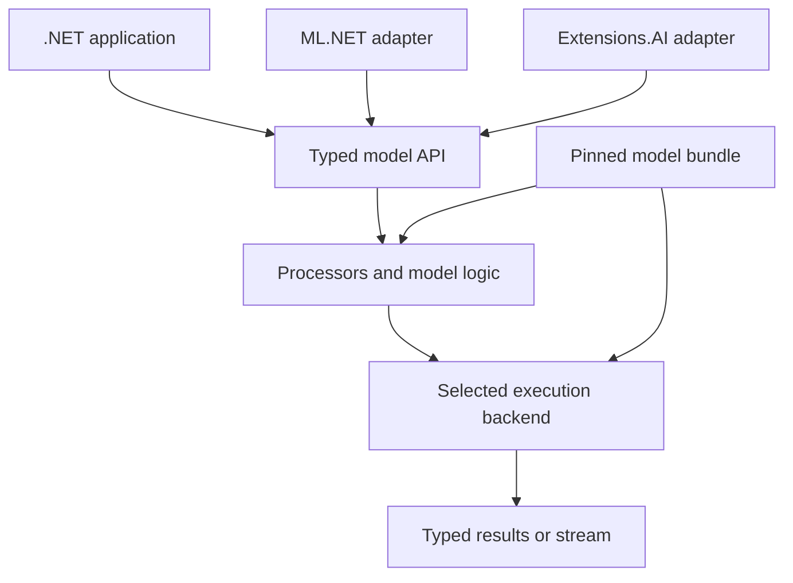

# Fast, faithful AI for .NET

## Organization and model delivery pipeline plan

**Version:** 0.3 — 4 October 2026  
**Status:** Proposed execution plan; no repositories, packages, or services have been created by this document.  
**Planning owner:** Mark  
**Working scope:** An independent open-source GitHub organization delivering maintained .NET implementations and integrations for deep learning models, modern LLMs, and tokenizers.  
**Planning assumption:** One hands-on technical maintainer initially, supported heavily by development agents. Timelines are effort estimates, not commitments or measured results.

> **Repository note (added 2026-10-05):** This repository (`starlinghq/starling`) holds the four planned repositories as top-level directories (`.github/`, `ai-dotnet/`, `model-pipeline/`, `tokenizers-dotnet/`) until each one justifies a split. The package prefix is `Starlings` in place of the illustrative `Org.AI`. Open kickoff decisions are tracked in [`docs/kickoff.md`](../kickoff.md).

> **Status (2026-10-18):** The plan text below is unchanged; this note records where execution stands. The tokenizer is now its own repository and package: `Starlings.Tokenizers` `0.3.0` is released from `starlinghq/tokenizers`, and `tokenizers-dotnet/` is not in this repository. ai-dotnet `0.2.0`, the first release with Stable profiles, was published to nuget.org on 2026-10-17 from tag `ai-v0.2.0` (15 packages; [`docs/releases/ai-0.2.0.md`](../releases/ai-0.2.0.md)). Every registry profile is Stable (13; e5, GLiNER2, EmbeddingGemma 2 text, image and video, and Qwen3.5-0.8B, CPU and CUDA on an RTX 3090): see [`docs/catalog/README.md`](../catalog/README.md) and the tracking entries in [`production-readiness.md`](production-readiness.md). Kev-0.8B and Kev-4B (`Starlings.Models.Kev`, Experimental, #91), `Starlings.Models.Bert` and `Starlings.Models.QwenChat` are on `main` as source only and are not published.

## 1. The mission and the evidence needed to earn it

Make .NET a dependable place to use modern AI: straightforward installation, faithful model behavior, responsive execution, current model support, and transparent maintenance.

The organization's promise should be: **a model supported here comes with a usable .NET API and reproducible evidence of what works, how fast it runs, and which upstream behavior it preserves.**

Success requires two kinds of responsiveness:

- **Runtime responsiveness:** predictable latency, efficient batching, low allocation overhead, useful streaming, and controlled resource consumption.
- **Maintenance responsiveness:** prompt triage of upstream changes, visible compatibility status, repeatable updates, and regression fixes that reach users quickly.

The distinctive asset is the complete delivery process: reference execution, export or backend selection, C# implementation, tokenizer fidelity, performance engineering, conformance tests, documentation, packaging, and ongoing updates. A collection of thin wrappers alone would not establish the desired credibility.

Using native compute libraries is compatible with this mission. Python applications also depend on native execution engines. A C# application using ONNX Runtime, LibTorch, or llama.cpp is a real .NET AI application; its backend must simply be disclosed. Pure managed implementations are valuable where they improve portability, performance, deployment, or control. They are an engineering choice rather than a universal requirement.

The first public evidence should demonstrate:

1. A conventional deep learning model used through a polished, fast C# API.
2. A complex extraction model with demonstrated behavioral fidelity.
3. A modern local LLM with correct tokenization, prompt formatting, and streaming.
4. An independently owned .NET tokenizer library with published conformance and throughput results, capable of releasing fixes without waiting for another project's release.
5. An upstream change taken through the delivery pipeline without weakening the quality gates.

The first four can progress at different maturity levels. A launch must distinguish stable support from preview work.

## 2. Architecture decisions

| ID | Decision | Consequence |
| --- | --- | --- |
| ADR-01 | Own an independent .NET API and delivery pipeline. | Model coverage and releases do not depend on ML.NET accepting PRs. |
| ADR-02 | Keep ML.NET integration optional. | Suitable operations compose with existing pipelines without shaping every model API around rows and columns. |
| ADR-03 | Implement Microsoft.Extensions.AI adapters for chat and embeddings. | Applications can consume models through existing ecosystem contracts. |
| ADR-04 | Start with direct ONNX Runtime for exportable encoder and vision models. | Reuse an established C# execution API; keep preprocessing and decoding in explicitly tested code. |
| ADR-05 | Use an existing generation backend for the first LLM. | Choose ONNX Runtime GenAI or an existing llama.cpp binding based on the selected model and target hardware. Do not build both for the pilot. |
| ADR-06 | Keep a TorchSharp route available for model implementations that benefit from it. | ONNX export is a preferred route for suitable models, not an admission requirement for the whole organization. |
| ADR-07 | Treat tokenizers, processors, templates, and decoding as part of the model. | A successful tensor inference is insufficient evidence of compatibility. |
| ADR-08 | Ship code, model assets, and verification evidence as separately versioned artifacts. | Large weights do not inflate every NuGet install, and every tested combination has an exact identity. |
| ADR-09 | Keep reference behavior and optimized variants separate. | Quantization or approximate algorithms cannot silently change a fidelity claim. |
| ADR-10 | Make execution capabilities explicit per model/backend/platform. | Streaming, batching, training, adapters, and AOT are not assumed merely because an API exists. |
| ADR-11 | Automate implementation aggressively; protect evaluation and release authority. | Agents can produce and repair candidates, but cannot declare success by weakening tests. |
| ADR-12 | Use a small number of repositories and a small stable catalog first. | Maintainer attention goes into useful implementations rather than repository administration. |
| ADR-13 | Own the production tokenizer implementation, API, packages, conformance suite, and release cadence. | Supported tokenizer profiles do not depend on Microsoft.ML.Tokenizers being updated or released. |
| ADR-14 | Contribute tokenizer fixes upstream through a parallel maintenance track. | An upstream PR's acceptance or release date never gates this organization's qualified release. |
| ADR-15 | Make a `tokenizer.json` pipeline interpreter the tokenizer library's first deliverable. | A model whose pipeline uses supported components needs a new asset and a conformance run, with no code release. |

These are proposed project decisions. Relevant existing integration points are documented in sources [S1–S8]. The ML.NET GenAI removal motivates organizational independence; it does not establish that every .NET AI project is in decline [S12]. Tokenizer ownership (ADR-13, ADR-15) has its own evidence: the Microsoft.ML.Tokenizers release history summarized in section 6 [S14–S16].

## 3. Who the organization serves

| Consumer | What they need | Deliverable |
| --- | --- | --- |
| Application developers | Install a package, load a known model, call a typed API. | Focused NuGet packages, local model bundles, short examples. |
| ASP.NET service developers | Cancellation, concurrency limits, observability, stable resource ownership. | DI integration and a production-oriented service example. |
| ML.NET users | Use modern embeddings and model scores in existing pipelines. | Optional transformers with documented schema and persistence behavior. |
| AI framework authors | Reusable chat and embedding implementations. | Microsoft.Extensions.AI integration plus lower-level task APIs. |
| Model researchers and upstream maintainers | Make a new architecture usable by .NET developers. | Admission template, reference harness, contribution guide, reproducible reports. |
| Operators and enterprise teams | Exact versions, offline use, supported environments, regression visibility. | Compatibility records, immutable assets, diagnostics, rollback guidance. |

Public examples should solve complete small problems: multilingual classification, schema-based extraction, semantic retrieval with reranking, and local streamed chat. They should stay independent of any particular cloud account or orchestration product.

### 3.1 Landscape and first consumer

Publish a short comparison against existing .NET options in the encoder and tokenizer lane before M1 exits (P-028). Candidates to survey, with current versions and status verified at kickoff: Semantic Kernel's ONNX embedding connector, SmartComponents.LocalEmbeddings, FastBertTokenizer, and .NET bindings to the Hugging Face Rust tokenizers such as ErgoX.TokenX. The comparison states what each one already covers and where this organization's evidence and release cadence differ.

Name one real consumer for the encoder package before M1 exits: a project or team that installs the preview and reports back. Until a consumer exists, score the user-demand criterion in section 7 from observable signals such as upstream repository activity and model-request issues.

## 4. Organization and repository structure

Select a distinct organization name and NuGet prefix during kickoff. Until then, this plan uses **Org.AI** as an illustrative package prefix; it is not an availability or ownership claim.

Start with four repositories. Tokenizers are a standalone ecosystem product with an independent release lifecycle:

| Repository | Contents | Initial responsibility |
| --- | --- | --- |
| `.github` | Organization charter, contribution policy, issue templates, support policy, ownership, security reporting. | Mark as accountable maintainer; add a second trusted release owner as the project grows. |
| `ai-dotnet` | .NET libraries, backend adapters, model implementations, tests, examples, documentation, microbenchmarks. | The main product repository. |
| `model-pipeline` | Model registry, manifests, export recipes, reference runners, evaluation orchestration, upstream watchers, report generation. | The reproducible delivery system. |
| `tokenizers-dotnet` | Owned .NET tokenizer implementation, data-format loaders, conformance fixtures, benchmarks, upstream change tracking. | Independently usable tokenizer product and release lane. |

Keep model definitions as directories in these repositories initially. Split a family into its own repository only when it has an independent owner, release lifecycle, or dependency burden that justifies it. Generate the model catalog from the registry rather than maintaining a second manual support list.

Proposed package boundaries:

| Package family | Purpose |
| --- | --- |
| `Org.AI.Abstractions` | Small task contracts, capability metadata, result types, lifecycle contracts. |
| `Org.AI.Runtime.Onnx` | ONNX Runtime integration and resource ownership. |
| `Org.AI.Tokenizers` | Owned tokenizer algorithms, processing pipeline, format loaders, and public API; independently versioned and usable without model runtimes or ML.NET. |
| `Org.AI.Tokenizers.Compatibility.*` | Optional ecosystem adapters or comparison utilities; never required by the production tokenizer core. |
| `Org.AI.Models.*` | Family implementations: preprocessing, graph orchestration, decoding, typed APIs. |
| `Org.AI.Generation.<Backend>` | The chosen LLM backend integration. |
| `Org.AI.Extensions.AI` | Standard chat and embedding adapters. |
| `Org.AI.MLNet` | ML.NET estimators, transformers, schema mapping, persistence support. |
| `Org.AI.Hosting` | Optional DI, resource admission, diagnostics, and service helpers. |

These are conceptual boundaries. Create packages when a real consumer requires them; do not publish empty abstractions or a package for every class. Avoid a mandatory meta-package that installs every native backend.

## 5. Execution architecture

The core library exposes task-specific APIs. Runtime selection is a separate decision from the task contract.

### 5.1 Task contracts

Provide separate interfaces for embeddings, classification, extraction, reranking, generation, and later vision/audio. Keep rich task options available; a universal `Predict(object)` method would erase the distinctions that make the implementations useful.

For the first models, define:

- Single-item and explicit batch APIs where supported.
- Async request and cancellation contracts where meaningful.
- Incremental generation through an asynchronous stream with terminal status and usage metadata.
- Immutable model configuration and separate request-specific settings.
- Typed labels, scores, spans, relationships, and structured results.
- A capability descriptor reporting supported features and limitations.
- A way to inspect the loaded model, tokenizer, backend, provider, and artifact identities.
- For classification, a request shape with one input state and many typed questions (yes/no, single choice, ordinal score), each answered with probabilities. This matches the System One request used by Jev and Kev [S17, S18], so a hosted client and a local model can share one interface.

Do not call an API asynchronous merely because it wraps blocking work in `Task.Run`. Document whether cancellation removes queued work, interrupts supported native execution, or stops only at the next generation step. Expose that limitation rather than promising immediate GPU preemption.

Keep backend tensor types out of the common public API. Offer a clearly marked advanced backend API where zero-copy or device-resident workflows require it. Owned memory and disposal rules must be explicit; borrowed buffers must not outlive their native owners or an awaited operation.

### 5.2 Backend selection

| Route | Good initial use | Admission conditions |
| --- | --- | --- |
| Direct ONNX Runtime C# | Embeddings, classifiers, rerankers, supported extraction/vision graphs. | Verified export, operators, dynamic dimensions, provider behavior, and task parity. |
| ONNX Runtime GenAI | Supported decoder models needing an existing generation loop. | Exact architecture/config supported; validate the chosen C# API version and platform. |
| Existing llama.cpp binding | Models and hardware well served by the GGUF ecosystem. | Pin matching binding/native versions and the exact conversion/quantization recipe. |
| TorchSharp | Direct neural-network implementations or export-resistant control flow. | Demonstrated fidelity, maintainable architecture port, and supported native dependencies. |
| Managed .NET implementation | Tokenization, preprocessing, decoding, small networks, measured hot paths. | Competitive performance and a clear reduction in integration or deployment cost. |

ONNX Runtime GenAI documents a C# generation API but still labels that API preview; isolate it behind an adapter [S4]. LLamaSharp already integrates llama.cpp; evaluate contributing to it before creating a competing binding [S5]. TorchSharp exposes the native library used by PyTorch [S6].

If two backend stacks load incompatible native dependencies into one process, solve that during compatibility testing. A supported out-of-process worker can be a later escape hatch, but it must be labeled as such and its overhead measured. Never silently switch from local execution to a remote service.

### 5.3 Performance and lifecycle rules

Reuse loaded sessions and model weights. Start with explicit batches before introducing a shared scheduler. Add bounded queues, length bucketing, and resource admission only when an end-to-end benchmark justifies them.

Separate queue time, preprocessing time, inference time, and decoding time in diagnostics. Put a bound on resident models and in-flight requests. Account for weights, temporary tensors, output buffers, and LLM KV caches; weights alone do not determine capacity.

Generation state belongs to a request or an explicitly owned conversation. Test concurrent requests for state leakage. Model replacement should validate and warm the new version, atomically route new work to it, allow old work to drain, then dispose the old instance. Do not dispose a model while an adapter or active request still uses it.

The initial runtime should use .NET 10 as the primary implementation and sample target, with exact SDK/runtime versions pinned in CI. Microsoft's current policy lists .NET 10 as active LTS; .NET 8 and 9 are close to end of support at this plan's date [S11]. Add older targets only for a named consumer and a funded support window.

Native AOT is a per-package/per-backend qualification, not a launch-wide claim. Validate trimming and native loading in a standalone executable before advertising it [S10]. A compiled API target does not certify every runtime identifier or provider.

## 6. Tokenizers and processors are a core workstream

Each model bundle must identify its tokenizer implementation/package version, asset revision, vocabularies, normalizer, pre-tokenizer, postprocessor, added tokens, special-token policy, decoder, and relevant chat template. Image and audio processors receive the same treatment when those modalities enter the catalog.

**Own and ship `Org.AI.Tokenizers` as the production tokenizer dependency.** The organization controls its implementation, public API, package publishing, compatibility matrix, bug fixes, and performance roadmap. The tokenizer core must not depend on Microsoft.ML.Tokenizers, directly or transitively. Upstream software remains valuable as source material, a differential reference, and a contribution destination.

Release lag is the reason for ownership. The Microsoft.ML.Tokenizers package history shows the bottleneck:

| Event | Date | Ref |
| --- | --- | --- |
| Stable 1.0.0 | 2024-11-14 | S14 |
| Servicing 1.0.1, 1.0.2, 1.0.3 | 2025-01-15, 2025-02-26, 2025-10-28 | S14 |
| Stable 2.0.0 | 2025-11-11 | S14 |
| PR #7556 opened to map gpt-5.1 onto the existing O200kBase encoding | 2025-11-18 | S15 |
| Next package of any kind, 3.0.0-preview.26160.2 | 2026-03-12 | S14 |
| Request for Hugging Face BPE format support, issue #6901 | Opened late 2023; milestone ML.NET 5.0 | S16 |

Stable releases follow the November .NET cycle. A lookup-table change proposed one week after 2.0.0 had no package to ship in for about four months, and the listing showed no stable release after 2.0.0 when checked on 4 October 2026. Re-verify these dates against NuGet and the merge status of PR #7556 at kickoff; the listing was read through a search index.

Seed the library through a scoped audit and source extraction/fork of suitable existing implementations, including Microsoft.ML.Tokenizers where useful, then maintain that source in `tokenizers-dotnet` under the organization's namespace. The ML.NET repository's published license is MIT [S13]; record the exact source revision, preserve applicable notices, and inventory any separately licensed assets/dependencies before adopting them. This is independently maintained source with an independent release cycle. Wrapping the upstream NuGet package would not satisfy the ownership requirement.

The first deliverable is an interpreter for `tokenizer.json` pipelines (ADR-15), scoped to the components the pilot profiles use. Forked algorithm classes still need per-model wiring in code, and that wiring reproduces the upstream bottleneck. With the interpreter, a model whose pipeline uses supported components needs a new asset and a conformance run. The M0 audit measures how much of the format the adopted source already covers and sizes the remaining work.

Favor managed C# for the initially supported tokenizer path, backed by measured optimization and exact conformance. Native implementations can remain optional reference/comparison tools or explicitly labeled acceleration providers. Hugging Face's reference implementation is Rust [S8]. Never claim ownership of an implementation merely because it is hidden behind the organization's interface.

### 6.1 Implementation coverage

Treat the tokenizer as a configurable processing pipeline rather than a table of recognized model names. Support pinned asset formats and processing semantics; a new model name often needs a new tested profile, while a new normalization or decoding rule requires implementation work.

| Component | Owned responsibility | Delivery rule |
| --- | --- | --- |
| Algorithm implementations | The BPE, WordPiece, Unigram, or other algorithm needed by an admitted profile. | Implement the pilot's exact profiles first; broader algorithm names are not universal compatibility claims. |
| Normalization and pre-tokenization | Unicode behavior, regex/whitespace rules, byte mapping, and segmentation. | Version and test against the model's reference behavior. |
| Special/added tokens and postprocessing | Match priorities, BOS/EOS, masks, padding, truncation, pairs. | Preserve exact token IDs and ordering. |
| Decoders and alignment | Token-to-text, incremental decode, byte fallback, and offset conversion. | Test streaming boundaries and declared normalization semantics. |
| Asset loaders | Supported portions of `tokenizer.json`, vocabulary/merges, SentencePiece assets, and tiktoken-style data as required by admitted models. | Unsupported operators or format versions fail explicitly; no approximate interpretation. |
| Template integration | Model chat-template application with the declared supported template semantics. | Keep template compatibility distinct from tokenization algorithm compatibility. |

Provide a model/profile registry that records supported operator combinations and exact reference revisions. Arbitrary custom Python tokenizers and unknown tokenizer graphs remain unsupported until explicitly implemented and qualified. Extend coverage through the same model admission process used elsewhere in this plan.

### 6.2 Conformance and performance

Build a reusable test corpus covering:

- ASCII, multilingual text, combining marks, emoji, surrogate pairs, whitespace, control characters, and empty input.
- Added/special tokens, BOS/EOS rules, truncation, padding, masks, pair encoding, and batch equivalence.
- Token IDs, decoded text under the reference normalization rules, and offset alignment.
- Chat-template rendering, role markers, generation prompts, tool schemas where supported, and streaming UTF-8 boundary handling.
- Delimiter and special-token look-alikes inside user text, including the escaping Kev applies before tokenization [S18].
- Image resizing/interpolation and channel/normalization settings; audio sample rate and feature extraction when applicable.

Offset semantics are especially important for GLiNER-style models. Declare whether offsets refer to UTF-8 bytes, Unicode scalar positions, or UTF-16 code units. Preserve the upstream convention in the fidelity API and provide an explicit conversion for C# string slicing. Test both on non-ASCII text. Do not silently reinterpret offsets.

Offer fast scalar and batch tokenization APIs. Report allocation count and bytes, cold initialization, warm throughput, and worst-case input behavior. Profile immutable vocabulary structures, caches, buffer ownership, vectorization opportunities, and bounded resource use before optimizing. Each optimization reruns the complete affected conformance suite.

Use the original model tokenizer as the fidelity reference. Compare against Microsoft.ML.Tokenizers, Hugging Face, SentencePiece, or tiktoken where applicable, with exact versions. A disagreement with Microsoft is not automatically a bug in the owned implementation; evaluate both against the model's declared reference semantics. Keep reference/comparison dependencies in test tooling and optional packages.

### 6.3 Independent release and upstream contributions

Run two tracks from the same reviewed fix:

1. **Product track:** reproduce the issue, implement the owned-source fix, pass protected conformance/performance gates, release an immutable tokenizer version, and qualify affected model bundles.
2. **Contribution track:** prepare a focused upstream patch with a reproducer and transferable tests/benchmarks, submit through the project's normal review process, and track acceptance and release separately.

The contribution track is a standing project responsibility, not a condition for releasing the product fix. Keep generic algorithm fixes separable from organization-specific APIs so upstreaming remains practical. Where a change is unsuitable upstream, record why and maintain it locally.

Maintain a provenance/change ledger linking imported commits, local changes, upstream PRs, accepted/rejected status, and released versions. Watch upstream for useful fixes and security/performance improvements; port them selectively through the organization's qualification gates. Do not perform unreviewed wholesale merges or replace qualified behavior solely because the upstream package changed.

Prove independence with a release exercise: disable the optional Microsoft comparator, build and test the supported production tokenizer path, install its package in a clean consumer, and ship a synthetic model-profile update or real fix while its upstream contribution is still pending. Confirm that no production package references Microsoft.ML.Tokenizers and no hidden comparison tool is needed to run inference. Synthetic fixes are release-process tests, not fabricated claims about upstream defects.

### 6.4 Integration with generation backends

The direct .NET path uses the owned tokenizer and template processing. Prefer generation backends that accept externally supplied token IDs and allow output IDs to be decoded by the owned implementation. Verify BOS/EOS, token-ID width, templates, and stop behavior at that boundary.

Some backend routes may require their own tokenizer or template engine. Declare that dependency per model/backend profile, compare it against the owned implementation, and mark tokenizer independence as unsupported for that route until it is removed. A backend-owned tokenizer must not silently become a second source of model semantics. The primary pilot route should satisfy the independence requirement; if it cannot, re-scope that preview or select another backend.

For the pilot LLM, tokenization and chat-template rendering are separate independence claims. Tokenization uses the owned Qwen BPE profile, which the Kev lane shares. Template rendering needs a C# renderer for the pinned model's template (P-029). Until that renderer is qualified, the preview may use the backend's template engine as a declared dependency, with rendered prompts compared against the upstream reference.

## 7. Initial model portfolio and admission policy

Separate stable anchors from current-model previews. A stable, reproducible model is useful for measuring runtime changes even after a newer architecture becomes popular.

| Priority | Candidate work | Why it is included | First completion target |
| --- | --- | --- | --- |
| P0 | One compact encoder embedding model with usable public weights and a proven export route. | Low-complexity path through the entire delivery system; reusable downstream features. | Preview at M1 and Stable CPU support at M3; batch API, Extensions.AI adapter, basic ML.NET integration. |
| P0 | Owned tokenizer library and the encoder's exact processing profile. | Shared foundation, independently useful .NET product, and release independence. | Production package without Microsoft.ML.Tokenizers dependency; conformance, benchmark, and standalone-release proof. |
| P1 | GLiNER2 family at a specifically pinned revision. | Differentiated, demanding test of faithful structured NLP in C#. | Complete support for the declared initial feature contract; preview until all gates pass. |
| P1 | One currently relevant small decoder-only LLM supported by an existing backend. Default candidate: a Qwen3.5 chat model in the 0.8B class, exact ID and revision fixed at admission. | Proves streamed local generation and current ecosystem integration; its tokenizer profile also serves Kev-0.8B. | Preview chat, correct template/tokenizer, stopping, cancellation, usage accounting. Confirm at M0 that the chosen backend supports the architecture. |
| P1 spike | Kev decision-model family at its tagged 1.0 revisions [S18]. | Open-weight member of the Jev model class, with upstream evaluation suites and visible demand. | M0 admission decision and execution-route result (P-027); implementation after the pilot unless it takes the M2 slot. |
| P1 | EmbeddingGemma 2 (`google/embeddinggemma-2`, Apache-2.0), text embeddings first. Added 2026-10-10 at the maintainer's request. | Current multilingual embedding model with strong demand; reuses the encoder path and adapters, and adds a Gemma-family backbone and a third owned tokenizer profile (SentencePiece-style BPE with byte fallback). | Admission spike (`model-pipeline/admissions/embeddinggemma-2.md`), then text embedding preview with Extensions.AI and ML.NET adapters. Image, audio and video towers stay out of the first contract. |
| P2 | One cross-encoder reranker or compact classifier. | Demonstrates task variety and reuses encoder infrastructure. | Stable typed API and benchmark. |
| P2 | One vision model such as an image classifier or detector. | Demonstrates that the organization serves deep learning beyond text. | Tested image processor and output semantics. |
| Later | Speech, multimodal generation, additional LLM architectures, training recipes. | Valuable expansion after the first families can be maintained reliably. | Independent admission and ownership. |

Choose exact model IDs and immutable revisions during the kickoff admission spike. Prefer a small current decoder that fits the available test hardware over a large flagship that makes every verification expensive. The initial launch does not depend on a specific unreleased model.

Sequence tokenizer profiles deliberately. During M0, identify the tokenizer used by GLiNER2's backbone at the pinned revision and choose a P0 encoder that shares its algorithm and asset format, so the first owned profile carries into M2. The Qwen BPE profile comes second and serves both the pilot LLM and Kev.

The GLiNER2 repository now describes capabilities beyond basic entity extraction, including constrained classification and joint extraction [S7]. Therefore, name support by upstream revision and feature set. Do not claim support for the moving repository as a whole. A legacy revision with full fidelity can coexist with a preview of newer capabilities.

Jev is TypeSafe AI's hosted classification model, in early access since September 2026. It is proprietary and TypeSafe has not disclosed the architecture [S17]. Under the access rule below, an in-process .NET Jev is blocked. The only Jev deliverable is an API client, labeled as a remote capability and excluded from in-process claims. A Jev-like model trained from scratch is a separate research project.

Kev is the admissible candidate in this class [S18]. It is an Apache-2.0 family of decision models on Qwen3.5 bases (0.8B, 4B, 9B) and a Qwen3.8 base (27B), with tagged Hub revisions, frozen evaluation suites, and an HTTP API that matches TypeSafe's System One request. Much of the G0 and G3 evidence already exists upstream.

The execution route is the risk. Kev scores options with a pointer head over hidden states at marker tokens and restarts position IDs for each question. Its Qwen3.5 bases mix attention with recurrent Gated DeltaNet layers. Backends that expose only a generation loop do not provide those hidden states. The M0 spike (P-027) tests a backbone export for Kev-0.8B and falls back to a TorchSharp port if the export fails. The earlier Qwen3-based Kev-0.6B is attention-only and is the fallback export target, though upstream no longer develops it. Kev implementation follows the pilot unless the M0 exit decision gives it the M2 slot in place of GLiNER2. The work-in-progress limit below applies either way.

Rank candidates with a weighted score: user demand 25%, backend feasibility 20%, reusable architecture coverage 20%, access/licensing clarity 15%, testability 10%, maintenance burden 10%. Lack of necessary access or redistribution rights is a hard blocker, not a low score that popularity can offset.

Limit work in progress to one new architecture and one small integration/update task. Add a new family only when a person accepts maintenance responsibility or the organization explicitly marks it experimental.

## 8. The repeatable model delivery pipeline

The model pipeline produces reviewed changes and evidence. Its initial implementation should be versioned command-line stages orchestrated by CI, with resumable, content-addressed artifacts. Do not build a general-purpose workflow platform before delivering the first model.

| Stage | Work | Required output and exit gate |
| --- | --- | --- |
| 0. Discover | Watch admitted upstream projects, model releases, ecosystem requests, and relevant dependencies. | Deduplicated candidate or update proposal with impact and effort estimate. |
| 1. Admit | Check user value, access, licenses, hardware needs, backend route, owner, and scope. | Approved model contract; blocked cases have a reason. |
| 2. Pin | Resolve code, weights, tokenizer, configs, templates, dependencies, and evaluation data. | Immutable source lock and artifact digests. |
| 3. Establish reference | Execute the original implementation in a reproducible environment. | Reference outputs and intermediate fixtures, feature checklist, tolerance policy. |
| 4. Implement execution route | Export graphs, configure a supported backend, or port an architecture. | Rebuildable implementation and an explicit unsupported-feature list. |
| 5. Implement .NET behavior | Tokenization, processors, model orchestration, decoding, typed results. | Working C# path without a Python runtime dependency for certified in-process models. |
| 6. Verify fidelity | Compare reference, export/backend, and C# behavior stage by stage. | Signed-off conformance report for the exact candidate. |
| 7. Optimize | Profile and address measured bottlenecks; create quantized variants separately. | Benchmark evidence plus rerun parity/quality gates. |
| 8. Integrate | Add applicable ML.NET/Extensions.AI adapters, samples, packaging, and docs. | Consumer tests, schema checks, and install-from-package demonstration. |
| 9. Qualify release | Run the supported platform matrix, resource tests, and clean installation. | Release candidate evidence tied to source and asset digests. |
| 10. Publish | Maintainer approves immutable code packages, bundles, catalog entry, release notes. | Reproducible release with known limitations and rollback instructions. |
| 11. Maintain | Detect changes, rerun affected checks, address reports, retire unsupported combinations; contribute relevant tokenizer fixes upstream in parallel. | Next candidate or an explicit support-status change; upstream PR status recorded separately. |

An ONNX path should compare original framework output to Python ONNX Runtime first, then compare that same ONNX artifact in C#. This isolates export errors from C# preprocessing or runtime errors. A native generation path compares the pinned native backend to the .NET binding separately from any comparison to the original unquantized model.

Use a visible failure taxonomy: export/operator, tokenizer, processor, precision, decoding, packaging, provider, concurrency, resource lifecycle, or reference instability. A failed stage should produce a minimal reproducer and a bounded next action. After two unsuccessful automated repair cycles, stop consuming compute and route the evidence to the maintainer.

Regenerate only stages affected by changed inputs. A tokenizer change invalidates downstream fidelity even if graph weights did not change; a README-only change does not require a full GPU qualification. The dependency graph should determine invalidation rather than an agent's impression of importance.

## 9. Artifact identity and model contracts

Use four identities:

1. **Implementation version:** semantic version of the C# package/API.
2. **Model bundle identity:** immutable weights, tokenizer, processor, template, and configuration digests.
3. **Runtime profile identity:** backend, native binaries, provider, precision, and tested environment.
4. **Evidence identity:** fixtures, evaluation datasets, thresholds, benchmark protocol, and results for that combination.

A public model card should resolve all four. A user must be able to identify the exact combination from a diagnostic command without exposing prompt text or local credentials.

Minimum manifest fields:

| Group | Required contents |
| --- | --- |
| Origin | Upstream URLs, code revision, weight revision, file digests, attribution. |
| Rights | Code and weight licenses separately; terms for tokenizers and datasets; redistribution decision and gated-download requirements. |
| Behavior | Tasks, input/output schemas, defaults, offsets, maximum lengths, unsupported features, truncation/error behavior. |
| Processing | Owned tokenizer package version and source revision, asset hashes and profile ID, algorithm/provider, normalization, template, decoding rules, optional backend-tokenizer dependency, image/audio processors if applicable. |
| Execution | Backend versions, graph signatures, operators/opset where applicable, native artifacts, provider options, precision, shapes. |
| Compatibility | Tested OS/architecture/provider combinations; streaming, batch, persistence, training, and AOT status. |
| Qualification | Reference runner, fixture versions, numeric tolerances, task-quality budgets, performance protocol, soak test configuration. |
| Maintenance | Named owner, maturity, latest verified upstream revision, review date, known issues, replacement/deprecation information. |

Represent each feature as supported, unsupported, experimental, or untested. Do not use missing values to imply support. A model bundle can expose a limited preview scope, but its package name, catalog entry, and examples must make that scope clear.

Store recipes and small fixtures in Git; use an artifact store or model hub for large files when permitted. Keep third-party weights outside ordinary NuGet code packages. An explicit acquisition command downloads allowed assets, verifies hashes, and records the resolved lock; normal inference works from local files and does not update itself.

## 10. Qualification gates

| Gate | Required evidence | Release rule |
| --- | --- | --- |
| G0 — Provenance | Immutable source and asset lock, accessible reference, rights recorded. | No public bundle without a clear distribution route. |
| G1 — Tokenization and processing | Exact discrete outputs on the declared conformance corpus; documented continuous preprocessing tolerances; owned implementation and independent release evidence. | No unexplained token, mask, template, or offset mismatch; tokenizer-independence claims require a verified independent production path. |
| G2 — Numerical behavior | Intermediate/final values within predefined tolerances for the reference profile. | NaN/Inf, shape, ordering, and threshold-boundary failures block fidelity claims. |
| G3 — Task behavior | Per-feature end-to-end outputs and held-out metrics; explicit limitations. | Every advertised feature passes, or the support claim is narrowed before release. |
| G4 — Resource correctness | Cancellation, concurrency, disposal, reload, repeated load/unload, and bounded memory. | No known state leakage or reproducible unbounded growth. |
| G5 — Performance | Controlled benchmark with raw results, environment manifest, and stage timing. | Meets the profile budget; exceptions keep the candidate preview and visible. |
| G6 — Distribution | Clean install from built packages, native dependency resolution, offline execution, version diagnostics. | No reliance on the developer's source checkout or local caches. |
| G7 — Integration | Adapter behavior, representative downstream use, persistence if advertised. | Integration badges only for tested capabilities. |

Phase the gates during the pilot. The first encoder release runs G0, G1, G2 and G6 in full. The remaining gates start as short checklists and get formal tooling when a real failure exposes a gap or when a profile is proposed for Stable. Every gate applies in full before any Stable label.

### 10.1 Fidelity policy

Set tolerances and reference fixtures before optimizing the candidate. Protect those files with review ownership. Agents may propose new edge cases or explain failures; they cannot silently increase tolerances, rewrite goldens, drop difficult examples, or disable a feature while retaining its badge.

Exactness is meaningful for token IDs, masks, schema encoding, deterministic discrete transformations, and canonical metadata. Floating-point comparisons require dtype/backend-specific tolerances chosen from reference behavior. Report maximum errors and distribution of errors as well as pass/fail counts.

For extraction, test empty results, overlapping spans, repeated entities, long inputs, truncation, confidence thresholds, schema order, nested output, and every advertised classification/relation mode. Canonicalize only differences explicitly declared semantically irrelevant. Do not sort or drop results merely to hide a mismatch.

For LLMs, test the prompt template, initial logits where accessible, cached-versus-uncached decoding, EOS and stop behavior, maximum-token boundaries, batch independence, and streaming reassembly. Greedy generation on stable fixtures is useful, but bit-identical long sampled generations across devices are not a universal requirement. Record generation parameters and seed behavior, and measure task quality on fixed evaluations. Missing logit access is an explicit evidence limitation.

Quantized models are separate variants. They must meet a task-specific quality budget and publish the difference from the reference profile. Do not label a quantized or approximate implementation numerically equivalent because its answers look plausible.

Separate development fixtures from a protected release evaluation set. Repeated exposure of holdout failures turns that set into development data; rotate and version it under maintainer control. Include licensed public task data and reviewed edge cases rather than relying entirely on examples invented by the implementation agent.

### 10.2 Operational tests

Use a one-hour repeated-request/load-unload test for initial candidate qualification and a longer periodic soak on the stable branch. Evaluate bounded working-set/native/VRAM behavior after warmup; a GPU allocator retaining a high-water mark is not automatically a leak. Record expected plateaus and make reproducible unbounded growth a blocker.

Exercise queue saturation, timed-out requests, disposal during shutdown, failed model initialization, malformed manifests, unsupported providers, and cancellation followed by reuse. Report cancellation latency at supported interruption points. Reject unsupported settings rather than silently ignoring them.

## 11. A benchmark program that can establish credibility

The benchmark suite should answer three different questions:

| Question | Comparison | What it can establish |
| --- | --- | --- |
| Does the implementation preserve the model? | Original implementation versus candidate, with precision and semantics accounted for. | Behavioral and task-quality fidelity. |
| Is the .NET integration efficient? | C# versus Python or native API using the same backend, artifact, provider, settings, hardware, and workload. | Binding, processing, allocation, and orchestration overhead. |
| Is the delivered solution useful? | Complete C# application versus a realistic alternative application at matched quality and resource limits. | End-to-end latency, throughput, deployment, and resource tradeoffs. |

Do not present a C# ONNX-versus-Python PyTorch result as an isolated programming-language comparison. If a deployment replaces an HTTP service with in-process inference, report both the service-boundary savings and the underlying compute results.

Measure the following where applicable:

| Area | Metrics |
| --- | --- |
| Setup | Package size, asset size, acquisition time, cold process start, model load, first request. |
| Single request | p50/p95/p99 latency with sample count, input size, and stage breakdown. |
| Throughput | Items/sec at fixed batch/sequence sizes; concurrency sweep under a latency bound. |
| Generation | Time to first token, prefill tokens/sec, decode tokens/sec, inter-token latency, complete response latency. |
| Tokenization | Bytes/sec, tokens/sec, latency by text category, allocation bytes and count. |
| Resources | Managed heap, allocations/request, GC pauses, native memory, VRAM, CPU threads, device utilization. |
| Quality | Task-specific accuracy/F1/ranking metrics and fidelity failures, paired with performance results. |
| Reliability | Error rate, cancellation response, saturation behavior, long-run resource trends. |

Freeze model inputs, seed policy, output lengths, warmup, thread counts, concurrency, clocks/power settings where controllable, driver versions, and precision. Capture actual execution-provider use and graph fallback. A nominal GPU configuration that runs important operations on CPU must be visible.

Use BenchmarkDotNet for managed microbenchmarks and a separate harness for realistic concurrent workloads. Include GPU synchronization in timed boundaries. Cold measurements use fresh processes; warm measurements pre-load models and identify remaining caches. Collect enough independent runs to distinguish variation from regression. Publish confidence intervals and sample counts; do not advertise reliable p99 results from a handful of requests.

Proposed initial performance objectives, to calibrate during the pilot:

- Headline number: C# against Python on the same backend, artifact, provider and hardware (the second comparison in the table above). Publish it with raw results for the encoder at M1.
- For small non-generation workloads, target p95 adapter/runtime overhead no greater than the larger of **1 ms or 10%** relative to direct C# execution of the identical backend workflow. This is a project budget, not an observed result. It guards the project's own adapter layer against regressions and stays an internal measure.
- For sustained generation, target at least **95% of matched native-backend decode throughput** where the workload is compute-bound. Report TTFT separately and investigate CPU-bound cases independently.
- Alert on a repeatable **greater than 5% performance regression** on controlled hardware. Block stable promotion until investigated or explicitly accepted with a documented reason and updated versioned budget.
- Keep parity and memory correctness mandatory even when an optimization improves speed.

Hardware noise can require a rerun; a failing performance comparison cannot be hidden by changing workload sizes or dropping the slow configuration. Publish unfavorable results and bottlenecks alongside improvements.

## 12. Agent-driven development with bounded authority

The pipeline is designed for substantial agent participation. Roles are logical responsibilities; they can be sequential jobs and do not require a large permanent agent swarm.

| Role | Produces | Cannot do independently |
| --- | --- | --- |
| Upstream scout | Candidate/update issue, pinned changes, relevance assessment. | Commit the organization to supporting every discovered model. |
| Reference investigator | Reproducible source environment, behavior inventory, fixtures. | Declare its own incomplete feature inventory complete without review. |
| Tokenizer maintainer | Owned implementation changes, format support, conformance reports, upstream patch candidates, provenance ledger. | Replace the production core with an upstream runtime dependency or make upstream acceptance a release gate. |
| Export/backend engineer | Export recipe, native/backend configuration, minimal reproducers. | Replace required model behavior with an approximation under the same identity. |
| .NET implementation engineer | C# code, processors, typed APIs, adapter candidates. | Modify protected reference evidence to make its code pass. |
| Fidelity evaluator | Differential reports, feature failures, regression cases. | Publish the candidate or waive required tests. |
| Performance engineer | Profiles and tested optimization proposals. | Trade away accuracy or safety of resource ownership without a separate reviewed variant. |
| Release/documentation assistant | Reproducible release candidate, model card, migration notes, examples. | Hold publishing credentials or approve its own release. |

Every job receives a task contract: exact input artifacts, permitted changes, allowed network destinations, compute budget, expected outputs, and stop conditions. Use ephemeral branches/worktrees and preserve structured logs plus useful reproductions. Build steps execute upstream code only in an isolated environment with no publishing credentials.

Untrusted repository text and model cards are data for the agent, not instructions that can change the pipeline's authority. Public PR jobs run without release secrets. Keep GPU jobs from untrusted contributions on isolated disposable runners, with manual admission before code reaches a privileged lab host.

Start with agents opening internal draft changes for review. Add auto-merge only for narrowly defined low-risk changes after the process has a track record. Core model behavior, native interop, fixture/tolerance changes, dependencies affecting execution, and releases always require maintainer review initially.

Keep the release gate independent of the implementation agent's self-report. Success comes from a deterministic evaluator operating on the candidate's immutable artifacts. A separate reasoning agent can review evidence, but is not a substitute for that evaluator.

## 13. CI, hardware, and compute cost

### 13.1 Test matrix

| Tier | When | Contents |
| --- | --- | --- |
| Fast PR checks | Every relevant PR | Build, API/schema checks, tiny reference fixtures, tokenizer corpus, CPU smoke tests, targeted unit tests. |
| Trusted model qualification | Admitted model/runtime changes | Full parity and task evaluations; platform-specific packages; selected GPU runs. |
| Controlled performance | Candidate promotion and scheduled baseline runs | Dedicated hardware comparisons with cached immutable assets and fixed software. |
| Periodic maintenance | Stable branch and upstream change detection | Soak, clean install, supported-profile revalidation, artifact availability. |

Start CPU qualification on Linux x64 and Windows x64. Add NVIDIA CUDA on Linux x64 when a named model requires it. macOS ARM64 is a valuable early expansion target, but CPU support and GPU acceleration are separate claims. Windows GPU, Linux ARM64, AMD, Apple acceleration, mobile, and WebAssembly need their own dependency and hardware evidence before receiving support badges.

Use existing machines for exploratory performance work. Publish a reference machine profile rather than requiring a purchase. A 16–24 GB GPU can be an initial small-model test target if available; it does not represent qualification for every architecture, context length, or concurrent load. Track hardware that is physically available separately from planned coverage.

Cache by immutable source, export, dependency, and hardware-profile identity. Keep CPU-only PR runs inexpensive. Run reference evaluation once per unchanged source bundle and reuse its outputs; optimization candidates still rerun all impacted checks.

### 13.2 Budget control

Set initial per-experiment bounds: two repair cycles, a wall-clock limit, a token budget, and a GPU-hour limit. An over-budget task returns partial evidence and a maintainer decision rather than silently continuing.

Use this monthly cost model:

**Total = hosted CPU runner usage + GPU hours × actual provider rate + agent usage + artifact storage/egress + operational services.**

An illustrative pilot allowance is 40 GPU-hours per month plus a small retained corpus. At a hypothetical $2/hour that line would be $80; this is an arithmetic example, not a quoted market price or complete budget. The admission spike should measure cost per model/update before setting a real budget. Separate maintainer time from compute cost in all planning.

## 14. Releases and support

Publish maturity and support separately:

| Status | Meaning |
| --- | --- |
| Experimental | Investigation or incomplete feature set; no production support claim. |
| Preview | Declared scope passes meaningful tests; API or platform support may still change. |
| Stable | Documented contract, qualification gates, owner, compatibility matrix, and regression support. |
| Maintenance | Existing pinned combinations remain supported, but new upstream features are not actively pursued. |
| Deprecated | Replacement and migration information published; support end date stated. |

Semantic-version code/API packages. Release the owned tokenizer library independently of model libraries and upstream projects. Use immutable bundle versions for weights and behavior-affecting assets. A tokenizer implementation/template fix that changes outputs requires a new qualified model profile and release note even if no public C# method changes. Production model locks include the qualified tokenizer package version; a newer tokenizer release is not automatically certified for every existing bundle. Never replace published bytes behind an existing identity.

Every release contains the code tag, model locks, dependency inventory, supported profiles, parity/quality summary, benchmark link, known issues, and reproducible installation instructions. Add release provenance/signing appropriate to the package infrastructure. Keep sensitive user data out of fixtures and benchmark archives.

The default runtime is local and offline after explicit acquisition. Telemetry is opt-in and records operational metrics without prompt/output text by default. Do not download a different model or install a runtime during a normal inference call.

Qualify save/load and cache behavior on a clean machine. Protect extraction paths and verify artifact sizes/digests before loading. Existing users should be able to pin a working profile while a new upstream version is in preview. Security or correctness problems can mark a release as affected without silently rewriting the user's dependency lock.

## 15. Ecosystem integration details

### 15.1 Microsoft.Extensions.AI

Implement `IChatClient` for chat-capable implementations and `IEmbeddingGenerator<TInput,TEmbedding>` for embeddings, reusing the same underlying model instance and task implementation. These interfaces are official ecosystem integration points [S1]. Keep the dependency in the adapter package.

Map cancellation, streaming, finish reasons, usage, supported request options, and model metadata deliberately. Expose unsupported tool calling, structured output, or multimodal features as unsupported. An interface capable of representing a feature does not prove that the selected model/backend implements it.

### 15.2 ML.NET

Start with an embedding transformer because vector output maps naturally to `IDataView`; add classification and reranking next. Extraction can use explicit vector/scalar columns or a documented secondary result representation. A JSON column may be useful, but it does not give downstream trainers direct structured feature semantics.

ML.NET's transformer contract provides a composition boundary [S9]. It does not make GPU scheduling or model serialization automatic. Validate the actual cursor/getter lifecycle, avoid recomputing inference when multiple output columns are requested, and define how variable-length results are represented. Do not assume each row callback can provide efficient GPU batching.

Offer an explicit batch-to-feature workflow for high-throughput embedding generation when it is more efficient than row-wise transformation. It can materialize feature data for subsequent ML.NET training while preserving the direct task API.

Treat these as separate badges: pipeline composition, model save/load, portable asset packaging, and training. The first pretrained estimator's `Fit()` initializes/validates a model; it does not train the upstream neural network. Mark persistence unsupported until an external consumer can restore the full model contract without relying on undocumented internal APIs. Allow an explicit external model-bundle reference where embedding all assets is inappropriate.

### 15.3 Existing runtimes and tokenizers

For execution runtimes, prefer existing integrations and upstream fixes unless independently maintaining an implementation is justified. For tokenizers, maintain the organization's owned implementation and independent release lane as a deliberate long-term responsibility. Establish issue/PR links and version constraints for each external dependency. Public contributions should include small reproducers and benchmark evidence that upstream maintainers can use.

The organization can become valuable to ML.NET, TorchSharp, tokenizer maintainers, and LLM bindings by delivering conformance suites and reusable processors as well as packages. A maintained model contract and test corpus can outlast one execution backend.

## 16. Governance and sustainable ownership

Mark initially acts as technical lead, API owner, and final release reviewer. Agents increase implementation throughput, but do not remove accountability for public claims, unsafe/native code, model semantics, or downstream compatibility.

Use a permissive license such as MIT for original project code, subject to the final organization decision. Preserve upstream licenses and notices for reused code. Model weights, tokenizer assets, and datasets retain their own terms; the repository's code license does not override them.

Define ownership for the core API, each backend, the tokenizer implementation/conformance/release lane, the release pipeline, and every stable model family. Tokenizer ownership includes independent fixes and upstream contribution follow-through. Initially the same person may cover several areas. Recruit a second trusted human release owner before promising broad support or expanding beyond a manageable stable catalog. Protected branches and release environments should not allow an implementation agent to approve its own change.

Use small design proposals for new public APIs, backends, model families, or changes to fidelity policy. Routine fixes can use an issue plus tests. Publish a contribution path with distinct tasks for model experts, .NET engineers, performance specialists, documentation contributors, and hardware testers.

Community-submitted hardware results are useful but should be labeled separately until reproduced under controlled conditions. Accept contributions to existing providers and model processors rather than requiring every contributor to understand the whole organization.

Limit support commitments to staffed work. Initial response goals are internal operating targets, not commercial SLAs. Provide a visible way to request a model, sponsor a maintenance lane, report regressions, or contribute test hardware. Sponsorship can fund new coverage, but should not change benchmark or release criteria.

Do not take on all of the deleted ML.NET GenAI source as a maintenance obligation. Review any reusable components against the selected portfolio, current backends, licensing, and fidelity requirements. Adopt code only when maintaining it is cheaper and more useful than integrating an established backend.

## 17. Milestones and staffing assumptions

Use completion gates to drive the schedule. The revised plan uses a **12–15-week pilot envelope**, assuming roughly **20–30 maintainer hours per week**, substantial agent implementation, existing CPU hardware, and access to a suitable GPU when required. That spans roughly 240–450 human hours; it is not a guarantee that a difficult new architecture will fit.

Allow an initial **60–120 incremental maintainer hours** for scoped tokenizer source adoption, the `tokenizer.json` pipeline interpreter for the pilot profiles, dependency separation, provenance, standalone packaging, and release-independence proof, subject to the M0 audit. Reserve ongoing tokenizer review and upstream follow-through capacity within the weekly budget. A novel algorithm or a full general-purpose tokenizer-format implementation can exceed this allowance; support only the pilot's declared profiles until the effort is measured.

Allow 10 to 20 maintainer hours in M1 for hand-curating the protected tokenizer and encoder release sets (P-030). Implementation agents do not author those sets.

Version 0.3 adds roughly 50 to 100 maintainer hours across the tokenizer interpreter, the Kev spike, the landscape survey, and holdout curation. The envelope absorbs that only at the upper end of the weekly hours. If the M0 audit lands high, M2 narrows first: either GLiNER2 or the LLM preview moves past the pilot.

| Milestone | Indicative window | Deliverables | Exit decision |
| --- | --- | --- | --- |
| M0 — Prove the route | Weeks 1–2 | Charter/repo design, model selection, reference fixtures, tokenizer source/dependency audit with `tokenizer.json` coverage measurement and adoption prototype, GLiNER2 feasibility spike and backbone-tokenizer check, Kev admission and execution-route spike, landscape survey started. | Can the organization own and release the required tokenizer profiles and preserve model fidelity at acceptable cost? |
| M1 — Deliver a complete small model | Weeks 3–6 | Independently released tokenizer package, encoder package labeled Preview, bundle/registry, clean installs, benchmark harness with the Python same-backend comparison, Extensions.AI embedding adapter, ML.NET composition prototype, landscape comparison, one named consumer. | Can a new user reproduce the evidence without the source checkout or an upstream tokenizer update? |
| M2 — Demonstrate the hard cases | Weeks 7–11 | GLiNER2 implementation against a fixed contract; one existing-backend LLM preview; owned tokenizer profiles and explicit backend boundaries. | Which candidates pass, and which remain explicitly preview or blocked? |
| M3 — Demonstrate maintenance | Weeks 12–15 | One upstream change end to end, tokenizer fix/profile release while upstream contribution is pending, controlled benchmarks, soak, catalog, migration example, Stable promotion of the encoder once qualification CI, soak and the compatibility matrix exist. | Publish only the combinations qualified for their advertised maturity; demonstrate independent release control. |

M2 is the largest uncertainty. It can extend beyond the pilot without blocking a useful encoder/tokenizer release. Do not reduce GLiNER2 fidelity or imply complete support to hit a date. If the feasibility spike indicates substantially more work, choose either a narrow explicitly named preview contract or a later complete release.

The pilot's minimum public outcome is one stable deep-learning implementation (Preview at M1, promoted to Stable at M3), an independently useful and independently released tokenizer library with a qualified profile, a reusable delivery pipeline, and transparent GLiNER2/LLM progress. The desired outcome adds both difficult demonstrations. A modest catalog with honest status is preferable to unstable production claims.

After the pilot, plan another 3–6 months around evidence and adoption: add the reranker/classifier and vision lane, qualify ARM64 where available, improve provider coverage, recruit maintainers, and reduce update effort. General-purpose training, distributed serving, multimodal generation, and bespoke GPU kernels enter only with a separate use case, owner, and budget.

Record weekly maintenance hours during M3 and publish a steady-state figure for the pilot catalog before committing to that expansion. Planning assumption until measured: 6 to 10 maintainer hours per week for tokenizer intake, upstream triage, and one model update per month.

### 17.1 First ten working days

| Days | Work | Concrete output |
| --- | --- | --- |
| 1–2 | Choose organization identity/prefix, confirm ownership policy, select model candidates, check GLiNER2's backbone tokenizer and fix the encoder ID and revision, audit tokenizer source/dependencies with `tokenizer.json` coverage and pin origins. | Charter, admission records, encoder ID recorded in this plan, tokenizer adoption decision and provenance. |
| 3–4 | Run the encoder reference/export; capture tokenizer/tensor fixtures; isolate the first owned tokenizer profile. | Source lock, reference runner, owned-source prototype, conformance corpus. |
| 5–6 | Implement direct C# encoder path using the owned tokenizer and explicit resource ownership. | End-to-end parity report and allocation profile. |
| 7–8 | Build standalone tokenizer and model packages, local acquisition, clean installation, and consumer example. | Packages consumed outside their source solutions without the upstream tokenizer package. |
| 9–10 | Compare matched backends; assess GLiNER2 scope; run the Kev execution-route spike; exercise independent tokenizer release and upstream patch preparation. | First evidence, tokenizer ownership gap list, Kev route result, and M1/M2 effort decisions. |

Do not spend the first fortnight building an autonomous discovery service or a polished catalog website. Start discovery as a simple scheduled query/report and produce one real model artifact before expanding the tooling.

## 18. Initial issue backlog

The following items are ready to turn into repository issues after the organization exists. Estimates should be assigned after the M0 spikes; acceptance criteria take priority over guessed dates.

| ID | Issue | Depends on | Acceptance criteria |
| --- | --- | --- | --- |
| P-001 | Establish charter, ownership, package prefix, and repository policies. | None | Purpose, scope, contribution route, release authority, and support states documented. |
| P-002 | Define model manifest and immutable source lock. | P-001 | Schema validates a real encoder and expresses unsupported capabilities. |
| P-003 | Build reference runner and fixture format. | P-002 | Pinned upstream execution recreates identifiable outputs and environment metadata. |
| P-004 | Create tokenizer conformance corpus and offset contract. | P-003 | Unicode, specials, padding, masks, offsets, and decode cases have reference expectations. |
| P-005 | Implement first ONNX Runtime execution component. | P-002 | Session reuse, disposal, diagnostics, provider validation, and bounded native lifetimes demonstrated. |
| P-006 | Deliver encoder preprocessing, pooling, normalization, and batch API. | P-003, P-004, P-005, P-024 | Single/batch outputs using the owned tokenizer match the reference contract across edge cases. |
| P-007 | Build staged fidelity evaluator. | P-003, P-006 | Export and .NET failures are distinguishable; protected thresholds cannot be changed by implementation jobs. |
| P-008 | Build matched-backend benchmark harness. | P-006 | Raw results include artifact IDs, environment, warm/cold separation, quality, and stage timings. |
| P-009 | Build model acquisition and verified local loading. | P-002 | Explicit download, integrity check, offline reuse, and clear failure for missing/gated assets. |
| P-010 | Publish a release candidate consumed by a clean sample app. | P-007, P-008, P-009, P-025 | Installation works outside the repository with no hidden source/cache or upstream tokenizer dependency. Labeled Preview and qualified by hand against the phased gates; Stable waits for P-018. |
| P-011 | Add Extensions.AI embedding adapter. | P-006 | Consumer sees standard embedding contract; batching and cancellation behavior are documented and tested. |
| P-012 | Add ML.NET embedding composition. | P-006 | Correct column/schema behavior and no repeated inference for multiple getters; persistence status explicit. |
| P-013 | Assess and implement ML.NET persistence. | P-012, P-009 | Fresh-process load resolves assets and reproduces outputs, or the capability remains unsupported with a documented external-bundle route. |
| P-014 | Complete GLiNER2 feature inventory and execution spike. | P-003, P-004 | Every targeted feature maps to reference evidence, implementation work, and an export/backend route. |
| P-015 | Implement the declared GLiNER2 profile. | P-007, P-014 | Tokenization, schema interpretation, spans, scores, decoding, and all advertised modes pass staged tests. |
| P-016 | Select and integrate one generation backend. | P-002, P-004, P-024 | Pinned generation with validated template, stopping, request state, native compatibility, and declared tokenizer ownership boundary. |
| P-017 | Add chat streaming and Extensions.AI integration. | P-016 | Streaming reconstructs the completed output; finish/cancellation/usage semantics are tested. |
| P-018 | Add qualification CI and controlled hardware profiles. | P-010 | Supported combinations have evidence; public PR execution cannot access release credentials. |
| P-019 | Add bounded concurrency and safe model replacement where needed. | P-008, P-018 | Saturation, cancellation, replacement, and memory tests pass; added complexity improves a measured workload. |
| P-020 | Add upstream change detection and scoped revalidation. | P-002, P-007, P-018, P-026 | Model/tokenizer changes create useful proposals and rerun all affected gates; upstream PR status cannot block an owned release. |
| P-021 | Generate catalog and evidence reports. | P-010, P-018 | Catalog reflects machine-readable maturity, feature scope, ownership, and test dates. |
| P-022 | Execute first maintained update and rollback drill. | P-020, P-021 | Both old and new profiles remain identifiable; regression and migration information is visible. |
| P-023 | Audit and adopt tokenizer source into the owned repository. | P-001, P-002 | Exact origins, dependency/asset inventory, notices, owned namespace, measured `tokenizer.json` component coverage of the adopted source, and justified initial profile scope. |
| P-024 | Implement and package the owned tokenizer core and first profile. | P-004, P-023 | Managed production path with no direct/transitive Microsoft.ML.Tokenizers reference, a `tokenizer.json` pipeline interpreter covering the pilot profiles' components, explicit unsupported operators, scalar/batch APIs, and passing conformance. |
| P-025 | Prove standalone tokenizer release independence. | P-024 | Clean consumer and release drill succeed with optional Microsoft comparator disabled and upstream patch unmerged; local fixture/evidence requirements remain enforced. |
| P-026 | Establish upstream contribution and selective intake workflow. | P-023, P-024 | Patch ledger, reproducible upstream test cases, intake/revalidation policy, and separate product/upstream release status. |
| P-027 | Run Kev admission and execution-route spike. | P-002, P-003 | Admission record; hidden-state export of the Kev-0.8B backbone attempted and compared with the PyTorch reference; TorchSharp or Kev-0.6B fallback result recorded; go/no-go for the M2 slot. |
| P-028 | Publish the landscape comparison and secure a first consumer. | P-001 | Comparison covers the section 3.1 candidates at verified versions; one named consumer agrees to install the M1 preview. |
| P-029 | Render the pinned LLM chat template in C#. | P-016, P-024 | Rendered prompts match the upstream reference on the template corpus; unsupported template features fail explicitly; the backend-rendered fallback stays labeled as a dependency until this passes. |
| P-030 | Curate protected release evaluation sets. | P-004 | Maintainer-curated tokenizer and encoder holdout sets, versioned where implementation jobs have no write access. |

Use the backlog to manage scope: P-001 through P-010 plus P-023 through P-025 establish the smallest complete delivery path with tokenizer independence. P-011 and P-012 establish interoperability; P-026 establishes the ongoing upstream contribution lane. The complex extraction and generation lanes then demonstrate breadth. Scheduler work is conditional on measured need, not a prerequisite to the first release. Version 0.3 added P-027 through P-030: P-028 and P-030 belong to the smallest delivery path, P-027 gates the Kev lane, and P-029 gates template independence for the LLM lane.

## 19. Measures of success

Measure trends from the first release rather than inventing impressive adoption targets.

| Measure | Initial target or policy | Why it matters |
| --- | --- | --- |
| Certified releases with full provenance | 100% | Every claim can be traced to code, assets, and evidence. |
| Owned tokenizer production profiles requiring Microsoft.ML.Tokenizers | Zero | Release independence is checked in production dependency manifests. |
| Qualified tokenizer releases waiting for upstream PR acceptance | Zero | Ecosystem contribution does not control the product's release schedule. |
| Tokenizer support lag | Days from an upstream tokenizer asset release to a qualified owned profile, reported per profile beside the same interval for Microsoft.ML.Tokenizers where it can be measured. | Turns the release-lag evidence behind ADR-13 into a tracked result. |
| Tokenizer upstream contribution tracking | Every reusable fix has a linked proposal or recorded reason for maintaining it locally. | Cooperation is an ongoing deliverable with visible follow-through. |
| Advertised features passing qualification | 100% | Partial implementations cannot hide behind broad model names. |
| Unsupported features/platforms explicitly listed | 100% | Users can make deployment decisions before integration. |
| Upstream triage latency | Goal: within 2 working days for admitted model families. | Measures attention without promising immediate support. |
| Simple compatible update delivery | Goal: qualified preview within 5 working days after triage. | Applies to existing architectures with unchanged contracts; publish missed targets and blockers. |
| New architecture intake | Feasibility/effort decision within 10 working days when capacity is available. | Gives requesters a realistic answer rather than an indefinite promise. |
| Regression triage | Reproducer, affected profiles, severity, and workaround recorded. | Reliability is visible even before a fix exists. |
| Maintainer time per update | Baseline during pilot, then reduce. | Indicates whether agents and automation improve sustainability. |
| Clean-install success | Tested every release for the declared matrix. | Verifies the artifact users actually consume. |
| Performance against matched backend | Meet the profile budget or disclose the gap. | Provides credible evidence that .NET integration is efficient. |
| Ecosystem use | Track independent examples, consumers, upstream contributions, and external maintainers. | More useful than raw repository stars alone. |

For freshness, show the exact latest known upstream revision and the exact latest verified revision, plus the date of the last check. An unchanged upstream revision is not stale just because its release is old. A new unsupported architecture should appear as a pending capability rather than quietly replacing a tested one.

The strongest launch story is a reproducible before/after case study: a useful workload, upstream correctness, measured .NET overhead, packaged consumption, and a subsequent update processed successfully. Publish enough data and scripts for another engineer to challenge the result.

## 20. Risks and decision triggers

| Risk | Early signal | Response |
| --- | --- | --- |
| Scope grows faster than maintenance capacity. | Many previews, unowned families, rising time-to-triage. | Freeze new families; improve one stable lane and recruit ownership. |
| ONNX export cannot preserve required behavior. | Repeated operator/control-flow workarounds or major quality loss. | Evaluate a direct backend/architecture port; retain blocked status until fidelity is demonstrated. |
| Tokenizer or template drift invalidates model results. | Correct tensors on simple text, failures on multilingual or structured inputs. | Pin processors, expand conformance, invalidate downstream evidence. |
| Owned tokenizer diverges without enough maintenance capacity. | Missed upstream fixes, difficult source ports, growing profile backlog. | Keep a provenance ledger, narrowly scoped commits, a named owner, and funded review capacity; restrict new profiles when needed. |
| A generation backend reintroduces hidden tokenizer dependence. | Backend ignores supplied token IDs or applies its own template/special tokens. | Verify the boundary, label limitations, and use an independent primary route. |
| Agent-generated fixes overfit tests. | Changed goldens/tolerances or unexplained benchmark improvements. | Protected gates, separate holdout evaluation, minimal failure reproductions, human review. |
| Native dependency conflicts complicate deployment. | Models work alone but fail together. | Explicit coexistence tests, aligned runtime packages, documented backend combinations. |
| Low throughput hides behind async APIs. | Thread-pool pressure or latency growth under load. | Profile actual blocking, use bounded execution, test realistic concurrency. |
| Fast release claims exceed staffing. | Update targets repeatedly missed. | Reduce the supported set and publish realistic maintenance status. |
| Benchmarks overstate language advantages. | Different precision/backends/hardware in headline comparisons. | Matched comparisons and separate task-quality evidence. |
| Weight/dataset access prevents reproduction. | Evaluation depends on unavailable credentials or unredistributable fixtures. | Separate gated profiles; choose an accessible anchor and disclose reproducibility limits. |
| A model family changes rapidly. | Expanding feature contracts every few weeks. | Maintain a pinned stable profile plus a separately scoped current preview. |
| A core maintainer becomes unavailable. | Release or support work has a single human dependency. | Recruit a second release owner; keep repeatable runbooks and conservative commitments. |

The organization should stop or narrow a lane when its maintenance cost persistently exceeds user value. Retirement is acceptable when it is explicit, documented, and leaves reproducible historical artifacts where distribution permits.

## 21. Defaults for kickoff

These choices allow useful work to begin without a long requirements phase:

- Independent organization and packages; name/prefix to be checked before creation.
- Mark as initial accountable maintainer, with agent assistance and explicit human-hour limits.
- .NET 10 for the primary runtime and examples.
- Direct ONNX Runtime encoder path first; Python allowed in reference/export CI, not required for certified in-process C# inference.
- Owned tokenizer source/API/releases with one exact profile first, one encoder, one pinned GLiNER2 contract, and one supported small LLM as the pilot portfolio.
- Tokenizer fixes and improvements contributed upstream in parallel; upstream acceptance and releases never gate the product's qualified release.
- Microsoft.Extensions.AI adapters for embeddings/chat; ML.NET adapter for appropriate operations.
- Four initial repositories including the independently released tokenizer product; schema-driven catalog; no custom workflow engine.
- Stable versus preview status per model profile and hardware combination.
- Protected parity and release gates, published evidence, explicit offline operation.
- `tokenizer.json` pipeline interpreter as the tokenizer library's first deliverable (ADR-15).
- M1 encoder release labeled Preview; Stable promotion at M3.
- Jev limited to a labeled API client; Kev admission and execution-route spike in M0.
- Pilot LLM default candidate: a Qwen3.5 chat model in the 0.8B class, pending the M0 backend check. (Settled: `Qwen/Qwen3.5-0.8B` at `2fc06364`, approved 2026-10-08; `docs/kickoff.md`.)
- Encoder model ID and revision: open. Fix both by day 2 and record them in the next revision of this plan. (Settled: `intfloat/multilingual-e5-small` at `614241f6`, approved 2026-10-08; `docs/kickoff.md`.)

The decisions remaining at implementation kickoff are concrete: organization identity, exact model revisions, available hardware, real weekly review capacity, and a compute budget. None needs to change the architecture recommended here.

## 22. Sources and factual baseline

Sources S1–S13 were checked on 3 October 2026 and S14–S18 on 4 October 2026. API pages and repositories can change; implementation work must pin versions. The architecture, milestones, thresholds, budgets, and governance above are recommendations, not claims made by the cited projects.

| Ref | Primary source | What it supports |
| --- | --- | --- |
| S1 | [Microsoft.Extensions.AI libraries](https://learn.microsoft.com/en-us/dotnet/ai/microsoft-extensions-ai) | Standard chat and embedding interfaces and ecosystem integration. |
| S2 | [ONNX Runtime basic C# tutorial](https://onnxruntime.ai/docs/tutorials/csharp/basic_csharp.html) | Direct C# inference, OrtValue, buffer access, and native resource lifecycle. |
| S3 | [ONNX Runtime I/O binding](https://onnxruntime.ai/docs/performance/tune-performance/iobinding.html) | Explicit control of inference input/output placement. |
| S4 | [ONNX Runtime GenAI C# API](https://onnxruntime.ai/docs/genai/api/csharp.html) | Generation, tokenization, template and generator APIs; preview status. |
| S5 | [SciSharp/LLamaSharp](https://github.com/SciSharp/LLamaSharp) | Existing .NET integration for llama.cpp and binding/native version alignment. |
| S6 | [dotnet/TorchSharp](https://github.com/dotnet/TorchSharp) | .NET access to the native library that powers PyTorch. |
| S7 | [fastino-ai/GLiNER2](https://github.com/fastino-ai/GLiNER2) | Model capabilities and upstream implementation to pin for fidelity work. |
| S8 | [huggingface/tokenizers](https://github.com/huggingface/tokenizers) | Upstream tokenizer reference and implementation ecosystem. |
| S9 | [ML.NET ITransformer](https://learn.microsoft.com/en-us/dotnet/api/microsoft.ml.itransformer) | ML.NET pipeline composition contract. |
| S10 | [.NET Native AOT overview](https://learn.microsoft.com/en-us/dotnet/core/deploying/native-aot/) | Deployment characteristics and limitations requiring qualification. |
| S11 | [.NET support policy](https://dotnet.microsoft.com/en-us/platform/support/policy/dotnet-core) | Current support status and the choice of .NET 10 as primary target. |
| S12 | [ML.NET GenAI removal issue](https://github.com/dotnet/machinelearning/issues/7720) | Removal rationale and preservation of independently useful trainers/tokenizers. |
| S13 | [ML.NET repository license](https://github.com/dotnet/machinelearning/blob/main/LICENSE) | Published MIT license and notice requirements for source adopted from that repository. |
| S14 | [Microsoft.ML.Tokenizers on NuGet](https://www.nuget.org/packages/Microsoft.ML.Tokenizers) | Package version history and release dates used in the section 6 lag table. |
| S15 | [dotnet/machinelearning PR #7556](https://github.com/dotnet/machinelearning/pull/7556) | gpt-5.1 mapping onto the existing O200kBase encoding, opened 18 November 2025. |
| S16 | [dotnet/machinelearning issue #6901](https://github.com/dotnet/machinelearning/issues/6901) | Open request for Hugging Face BPE tokenizer format support and its milestone. |
| S17 | [The Batch: Jev, a classification model](https://www.deeplearning.ai/the-batch/models-built-to-do-one-thing-well) | Secondary source for Jev's availability, request shape, undisclosed architecture, and the open-weight alternatives. Replace with TypeSafe's own documentation at admission. |
| S18 | [jaredpalmer/kev](https://github.com/jaredpalmer/kev) | Kev licenses, model sizes, tagged revisions, evaluation suites, architecture notes, and API shape. |

## 23. Revision history

| Version | Date | Change |
| --- | --- | --- |
| 0.1 | 2026-10-03 | Initial organization charter, architecture, model delivery stages, qualification policy, agent workflow, pilot milestones, issue backlog, and source baseline. |
| 0.2 | 2026-10-03 | Replaced upstream tokenizer-package reliance with owned source/API/releases; added ADR-13/14, standalone repository and package, source-adoption/conformance policy, backend boundary checks, parallel upstream contributions, four implementation issues, independence gates/metrics, and revised pilot effort. |
| 0.3 | 2026-10-04 | Review update: release-lag evidence for ADR-13 and new ADR-15 (`tokenizer.json` interpreter first); Jev defined as API-only and Kev added as an M0 admission spike; pilot LLM default candidate and tokenizer profile sequencing; template rendering separated from tokenization independence; M1 release labeled Preview with Stable at M3; gate phasing; landscape survey and first-consumer requirement; Python same-backend headline benchmark; holdout-curation and post-pilot maintenance hours; tokenizer estimate raised to 60–120 hours; support-lag metric; issues P-027 to P-030; sources S14–S18. |
| 0.3.1 | 2026-10-10 | Section 7: EmbeddingGemma 2 added as a P1 candidate at the maintainer's request (admission record `model-pipeline/admissions/embeddinggemma-2.md`, spike pending). |
